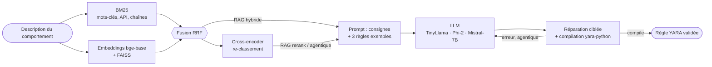
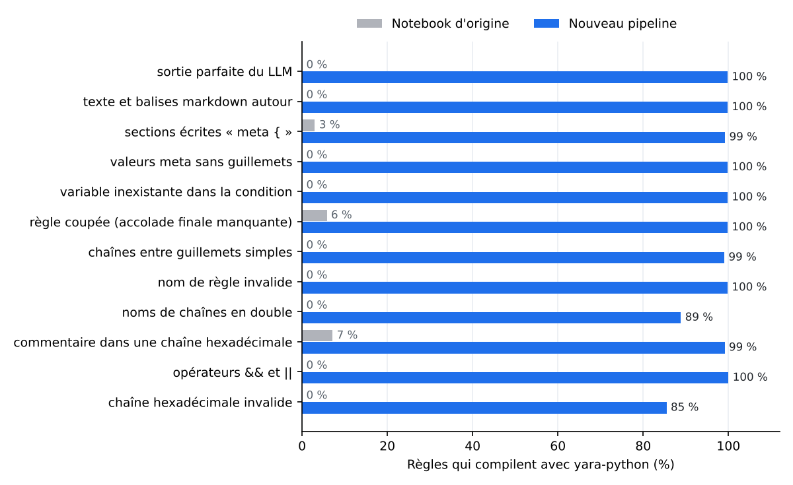

<div align="center">

# Génération de règles YARA par RAG

**Décrire un comportement malveillant en langage naturel et obtenir une règle YARA prête à l'emploi, vérifiée par le compilateur YARA**

[](https://github.com/Minyurano/mini-projet-NLP/actions/workflows/tests.yml)
[](https://colab.research.google.com/github/Minyurano/mini-projet-NLP/blob/main/notebooks/YARA_RAG_Colab.ipynb)


<a href="https://minyurano.github.io/mini-projet-NLP/" title="Ouvrir l'application en ligne">
  
</a>

[Démo en ligne](#démo-en-ligne) · [Résultats](#ce-que-la-version-2-corrige) · [Utilisation](#utilisation) · [Structure](#structure)

</div>

## Présentation

Écrire une règle YARA demande de connaître la syntaxe et les indicateurs typiques de chaque famille de
malware. Ce projet assiste l'analyste avec une architecture **RAG** (Retrieval-Augmented Generation) :

1. **Recherche** : les règles les plus proches de la description sont retrouvées dans une base de
   **9 698 règles publiques uniques** (Yara-Rules, signature-base, ReversingLabs ; chiffre de novembre 2026).
2. **Génération** : un LLM écrit une nouvelle règle en s'inspirant de ces exemples.
3. **Contrôle** : la règle est corrigée si besoin puis **compilée par yara-python** ; l'agent renvoie
   l'erreur exacte au LLM tant que la règle ne compile pas.

Mini-projet du module de NLP. Domaine : cybersécurité, détection de logiciels malveillants.

## Démo en ligne

[**minyurano.github.io/mini-projet-NLP**](https://minyurano.github.io/mini-projet-NLP/) fonctionne entièrement dans
le navigateur, sans installation : la description est comparée aux 9 698 règles (BM25), les règles les plus
proches sont affichées avec leur source, et une règle est **assemblée à partir de leurs chaînes**, avec la règle
d'origine de chaque chaîne. Cette règle compile toujours (vérifié par les tests).

La démo n'utilise pas de LLM (GitHub Pages n'a pas de GPU) : c'est la version « extractive » du projet
(`yara_rag/assemble.py`). Son moteur JavaScript (`docs/engine.js`) donne exactement les mêmes résultats que le code
Python, vérifié sur 134 requêtes et par un test automatique. La génération par LLM et l'agent correcteur
tournent dans le notebook Colab.

## Trois architectures RAG



| Architecture | Recherche | Génération |
|---|---|---|
| RAG hybride | BM25 + embeddings, fusion Reciprocal Rank Fusion | une génération, réparation, validation |
| RAG rerank | hybride puis re-classement par cross-encoder | une génération, réparation, validation |
| **Agentic RAG** | comme rerank | boucle : si la règle ne compile pas, l'erreur yara et la règle fautive sont renvoyées au LLM (3 essais) |

## Ce que la version 2 corrige

L'évaluation du notebook d'origine donnait **0 % de règles valides pour les trois architectures**
(archive : [`notebooks/archive/NLP_PROJET_initial.ipynb`](notebooks/archive/NLP_PROJET_initial.ipynb)).
Les causes ont été retrouvées et mesurées :

| Problème | Conséquence | Correction |
|---|---|---|
| Le prompt se terminait par le début de la règle, mais seule la suite générée était gardée | même une réponse parfaite du LLM ne compilait jamais | le début imposé est recollé à la suite avant validation |
| Post-traitement par remplacements globaux (`}}` → `}`, ajout d'un second `meta:`, regex sur toutes les accolades) | cassait aussi les règles correctes | réparation ciblée sur une vraie lecture de la règle (chaînes, hex, regex, commentaires) |
| L'« agent » renvoyait le même prompt, sans l'erreur | le LLM refaisait la même faute | le message d'erreur de yara-python est transmis au LLM |
| `yara-python` absent des dépendances, chemins `/content` en dur | notebook non reproductible | paquet `yara_rag/`, `requirements.txt`, base reconstruite par script |
| « Pertinence retrieval » ignorait la requête ; « Hallucination » ne vérifiait que les sections | métriques trompeuses | nouvelles mesures (voir plus bas) |
| Le choix du LLM dans l'interface ne changeait rien | démonstration trompeuse | le modèle choisi est réellement chargé |

### Fiabilité du post-traitement

500 vraies règles de la base, auxquelles on applique les défauts typiques des sorties de petits LLM,
puis compilation avec yara-python
([`benchmarks/repair_benchmark.py`](benchmarks/repair_benchmark.py)) :



Sur les 4 240 cas de défauts, **1,2 % des règles compilaient avec l'ancien post-traitement, 98,2 % avec le
nouveau**. Les règles déjà correctes de la base restent valides à 99,8 % après passage dans la réparation.

### Qualité de la recherche

Part des 5 règles retrouvées ayant le type de malware attendu, sans GPU (BM25 seul)
([`benchmarks/retrieval_variants.py`](benchmarks/retrieval_variants.py)) :

| Texte indexé par BM25 | 15 requêtes étiquetées | 500 requêtes leave-one-out |
|---|---|---|
| Notebook d'origine : description, `split()` | 77,3 % | 74,5 % |
| **Version 2 : description ×2 + tags + chaînes des règles** | **77,3 %** | **76,5 %** |

Indexer aussi les chaînes des règles (noms d'API, commandes, chemins) permet de répondre à des requêtes
comme « GetAsyncKeyState » ou « vssadmin », absentes des descriptions. Les mesures avec embeddings,
re-classement et LLM se lancent sur GPU (sections 3 et 6 du notebook, ou `scripts/evaluate.py`).

## Mesures d'évaluation

| Mesure | Signification |
|---|---|
| `syntax_valid` | la règle compile avec yara-python |
| `type_precision@k` | part des règles retrouvées du type attendu (requêtes étiquetées) |
| `query_coverage` | part des termes techniques de la requête présents dans la règle |
| `grounding` | part des chaînes générées présentes dans les règles retrouvées |
| `copy` | toutes les chaînes viennent d'une seule règle retrouvée (simple copie) |
| `attempts`, `latency_s` | essais de l'agent, temps de génération |

## Utilisation

### Sur Colab (recommandé, GPU T4 gratuit)

Ouvrir [`notebooks/YARA_RAG_Colab.ipynb`](https://colab.research.google.com/github/Minyurano/mini-projet-NLP/blob/main/notebooks/YARA_RAG_Colab.ipynb),
choisir un GPU (Exécution → Modifier le type d'exécution) et exécuter les cellules : installation,
base de règles, index, LLM, essai des trois architectures, évaluation, interface Gradio.

### En local

```bash
git clone https://github.com/Minyurano/mini-projet-NLP.git
cd mini-projet-NLP
pip install -r requirements.txt            # cœur : base, BM25, réparation, validation
pip install -r requirements-llm.txt        # embeddings, LLM, interface (GPU conseillé)

python scripts/build_dataset.py            # base de règles -> data/yara_rules.csv (~1 min)
python scripts/export_web.py               # base de la démo web -> docs/data/rules.json
python scripts/evaluate.py --models "TinyLlama (1.1B)" "Mistral-7B Instruct"
python -m pytest -q                        # 34 tests, sans GPU
```

```python
from yara_rag.dataset import load_dataset
from yara_rag.retrieval import Retriever
from yara_rag.generation import HFGenerator
from yara_rag.pipeline import YaraRAG

rag = YaraRAG(Retriever(load_dataset("data/yara_rules.csv")), HFGenerator("TinyLlama (1.1B)"))
g = rag.run("Keylogger capturing keystrokes with GetAsyncKeyState", "Agentic RAG")
print(g.valid, g.rule)
```

## Structure

```
├── yara_rag/
│   ├── parsing.py       lecture des règles (chaînes, hex, regex, commentaires), compilation
│   ├── dataset.py       construction de la base depuis les dépôts publics, typage, chargement
│   ├── retrieval.py     BM25, embeddings + FAISS, fusion RRF, re-classement
│   ├── generation.py    LLM Hugging Face (format de chaque modèle, 4 bits, décodage déterministe)
│   ├── repair.py        extraction et réparation ciblée des règles générées
│   ├── pipeline.py      prompt, architectures hybride / rerank / agentique
│   ├── assemble.py      règle extractive sans LLM (référence et démo web)
│   ├── metrics.py       mesures et évaluation
│   └── app.py           interface Gradio
├── scripts/             build_dataset.py, export_web.py, evaluate.py
├── benchmarks/          mesures sans GPU (réparation, variantes de recherche)
├── notebooks/           YARA_RAG_Colab.ipynb ; archive/ : notebook d'origine
├── docs/                démo web (index.html, engine.js, data/rules.json) et résultats des mesures
└── tests/               tests automatiques (pytest, GitHub Actions)
```

## Limites

- Une règle qui compile n'est pas forcément une bonne règle : elle doit être testée sur des échantillons
  réels et sur des fichiers sains (faux positifs) avant tout déploiement.
- Le type de malware de chaque règle est déduit de son nom, de ses tags et de sa description
  (règles par mots-clés) : c'est une étiquette approximative.
- Les résultats de génération dépendent du LLM : TinyLlama sert aux essais rapides ; comparer les modèles
  avec `scripts/evaluate.py` (non mesuré dans ce dépôt, faute de GPU lors de la refonte).

## Sources des règles

La base est reconstruite par `scripts/build_dataset.py`. La démo web en publie un extrait (nom, description,
auteur, lien, chaînes), accompagné des licences dans `docs/data/licenses/` ; chaque règle garde son auteur et
son lien vers sa source, et reste soumise à la licence de son dépôt :
[Yara-Rules/rules](https://github.com/Yara-Rules/rules) (GPL-2.0),
[Neo23x0/signature-base](https://github.com/Neo23x0/signature-base) (Detection Rule License 1.1),
[ReversingLabs YARA rules](https://github.com/reversinglabs/reversinglabs-yara-rules) (MIT).
